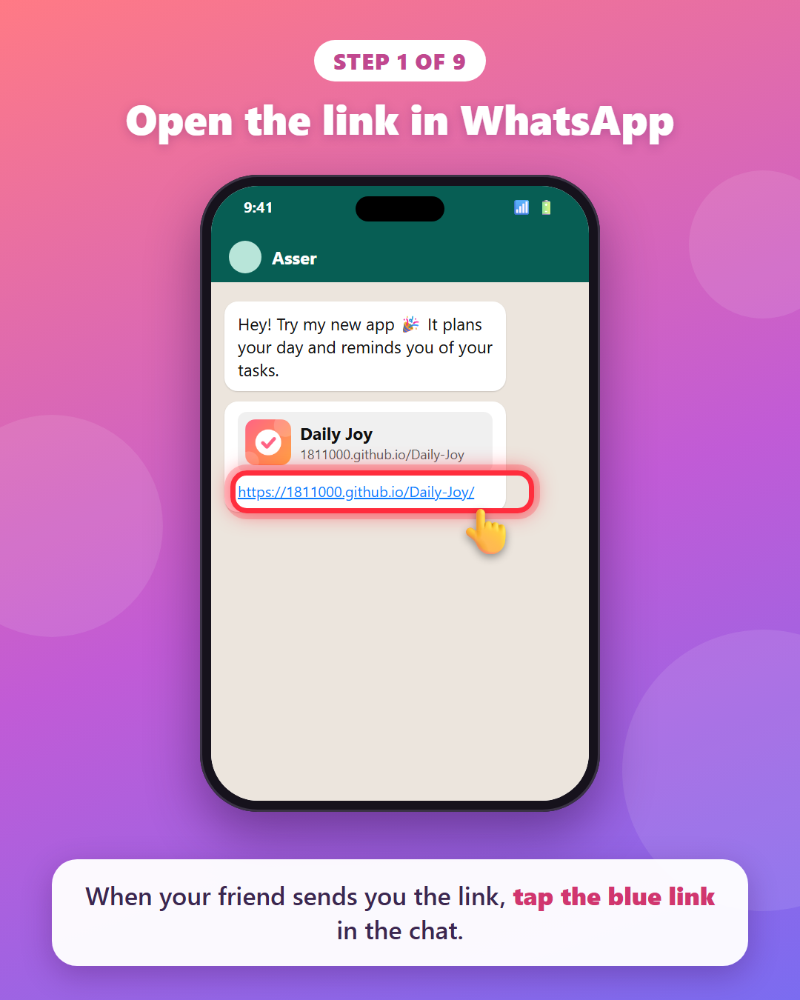
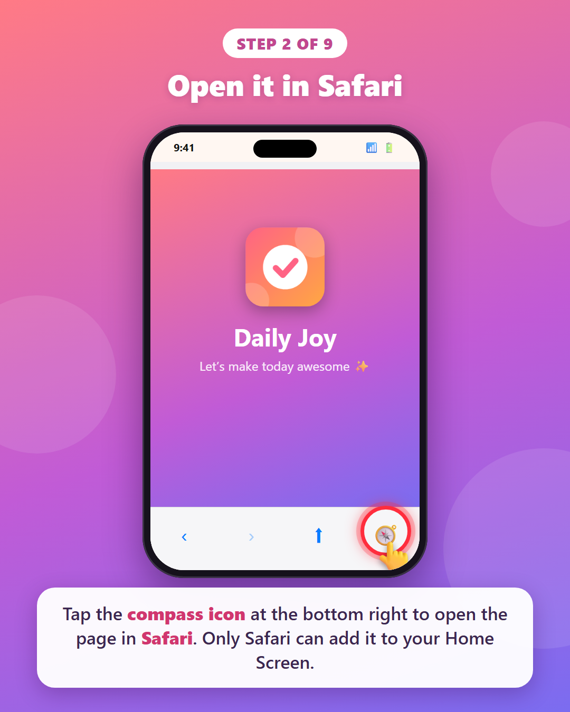
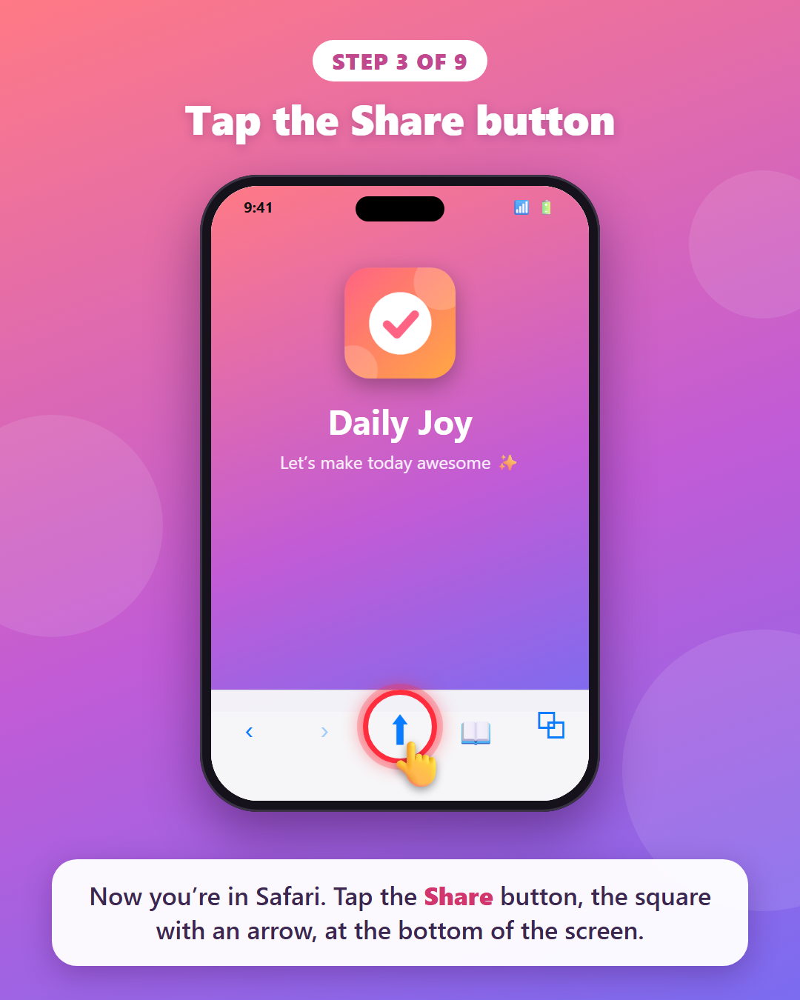
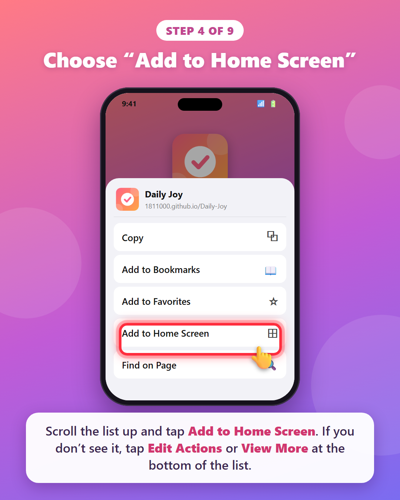
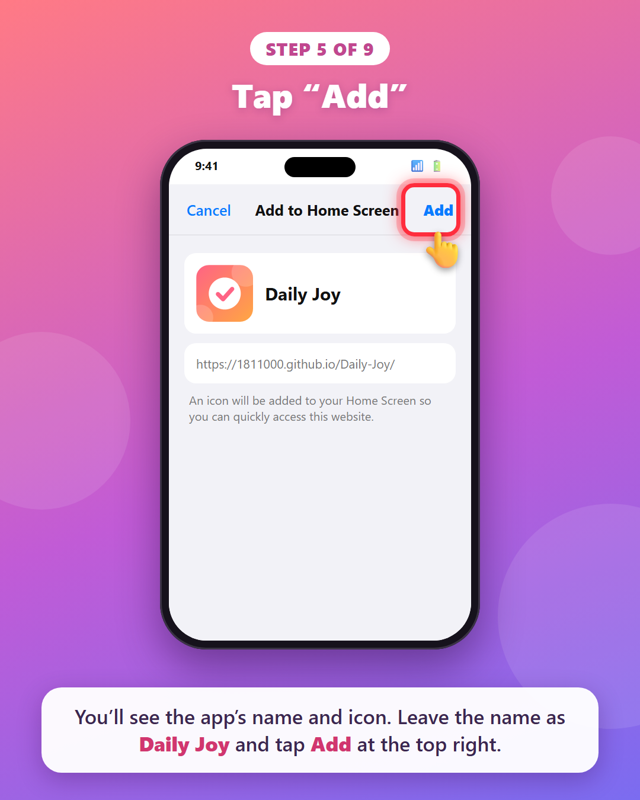
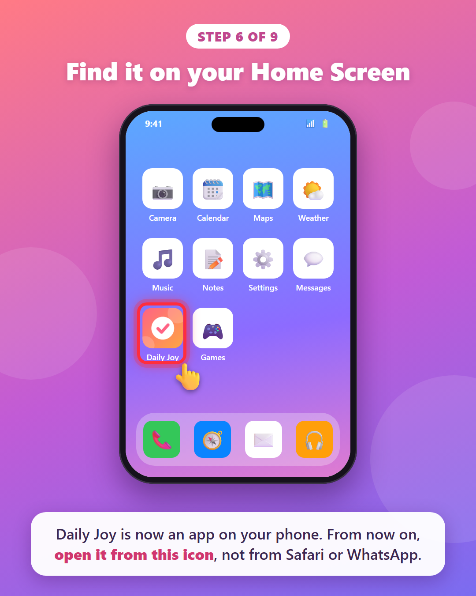
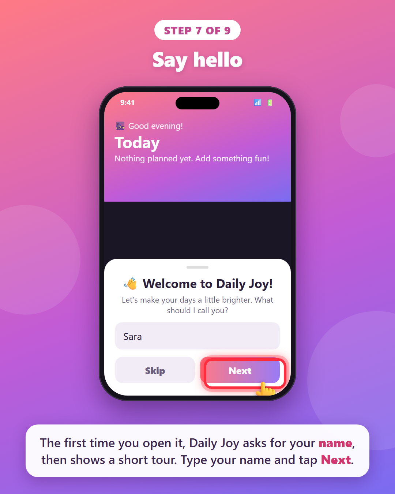
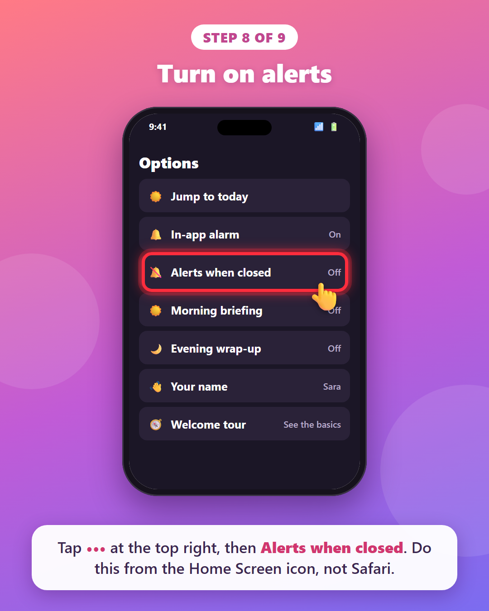
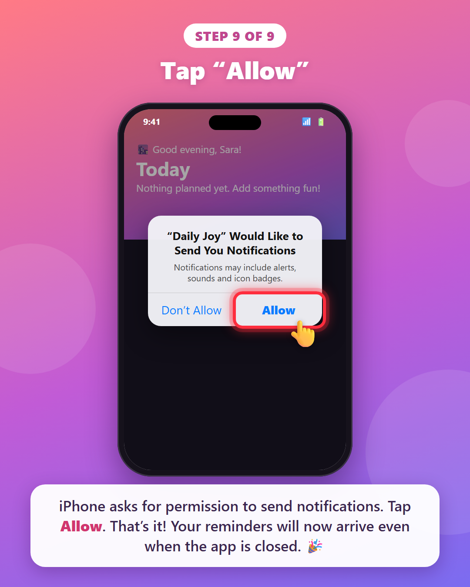

<p align="center">
  
</p>

<h1 align="center">Daily Joy</h1>

<p align="center"><b>Your cheerful little planner.</b><br>
A free to-do app and reminder that installs on your iPhone Home Screen. No App Store and no account needed.</p>

<p align="center">
  <a href="https://1811000.github.io/Daily-Joy/"><b>Open Daily Joy</b></a> &nbsp;|&nbsp;
  <a href="docs/Daily-Joy-iPhone-Install-Guide.pdf"><b>iPhone install guide (PDF)</b></a>
</p>

---

## What it does

- **Add tasks the easy way.** Type or speak naturally: *"Gym at 6pm tomorrow"*. You can even say several tasks in one sentence.
- **Swipe to act.** Swipe right to finish a task. Swipe left to move it to tomorrow.
- **Tap a task to edit it.** Change the time, add notes, make it repeat, or pick a category.
- **Reminders and alarms.** An alarm card with a chime appears when a task is due.
- **Alerts when the app is closed.** Optional push notifications (see [Alerts](#alerts-when-the-app-is-closed)).
- **Keep reminding.** Tap the bell on a task and it keeps nudging you until you finish it.
- **Daily rhythm.** Morning briefing, evening wrap-up and a weekly recap.
- **Friendly start.** A welcome screen asks for your name, then a short tour shows the basics. You can replay it any time from the menu.
- **Hey Siri, add a task.** Add tasks by voice with a Shortcut (needs the optional server).
- **Your data, your phone.** Light and dark themes, a voice language option, calendar sharing, and export/import of a `.json` backup.

## Install on iPhone

It takes about 2 minutes. Open the link in **Safari**. WhatsApp's own browser cannot add apps to the Home Screen.

1. Open the link in WhatsApp.
2. Tap the compass to open it in Safari.
3. Tap the **Share** button.
4. Choose **Add to Home Screen**.
5. Tap **Add**.
6. Find the Daily Joy icon on your Home Screen and open it from there.
7. Say hello and enter your name.
8. Open the menu and tap **Alerts when closed**.
9. Tap **Allow**.

| | | |
|:--:|:--:|:--:|
| <br>**1. Open the link** | <br>**2. Open in Safari** | <br>**3. Tap Share** |
| <br>**4. Add to Home Screen** | <br>**5. Tap Add** | <br>**6. Find the icon** |
| <br>**7. Enter your name** | <br>**8. Alerts when closed** | <br>**9. Tap Allow** |

A printable version of these steps is in [docs/Daily-Joy-iPhone-Install-Guide.pdf](docs/Daily-Joy-iPhone-Install-Guide.pdf).

> The pictures are illustrated mock-ups. Your iPhone's screens may look slightly different depending on the iOS version.

## Using the app

| I want to... | Do this |
|---|---|
| Add a task | Type it, or tap the microphone and say it. Include a time or day in plain words. |
| Finish a task | Swipe it right. |
| Move it to tomorrow | Swipe it left. |
| Change time, notes, repeat or category | Tap the task. |
| Move everything unfinished to tomorrow | Menu > Move unfinished to tomorrow. |
| Clear finished tasks | Menu > Clear done tasks. |
| See your week | Menu > Weekly recap. |
| Replay the tour | Menu > Welcome tour. |
| Check the alarm sound | Menu > Test alarm sound. |
| Back up or move your tasks | Menu > Export tasks / Import tasks. |

## Alerts when the app is closed

The app always rings while it is open. To also get alerts when it is closed, you need:

- the app installed on the **Home Screen** (iPhone does not allow alerts in a Safari tab),
- **iOS 16.4 or newer**,
- a tiny free server (a Cloudflare Worker) that sends the ping at reminder time.

The server code is in [`push-server/`](push-server/). Follow [push-server/README.md](push-server/README.md) to set it up. It takes about 15 minutes and is a one-time job. Until it is set up, the "Alerts when closed" item simply says "not set up yet" and everything else works as normal.

## Good to know

- **Privacy:** tasks are stored on your phone only. If you turn on alerts, the server sees just the reminder titles and times for your own phone, and nothing else.
- **iPhone limits:** iOS does not allow buttons inside notifications, widgets, or vibration from web apps. Sounds play only after you have touched the screen.
- **Updates:** when a new version is published, the app shows "A new version is ready". Tap it to update. Your tasks stay.
- **Moving to a new phone:** use Menu > Export tasks, then Import tasks on the new phone.

## For the developer

Daily Joy is a plain HTML, CSS and JavaScript web app (a PWA). There is no build step.

```
index.html            the page
app.js                all the app logic
styles.css            the look
sw.js                 service worker (offline, updates, push)
manifest.webmanifest  install info
icons/                app icons
cal.html              calendar share helper
push-server/          optional Cloudflare Worker for closed-app alerts
docs/                 install guide pictures and PDF
```

- **Publishing:** upload the app files to the repo root. GitHub Pages serves them at https://1811000.github.io/Daily-Joy/.
- **Releasing an update:** change `VERSION` in `sw.js` (for example `dailyjoy-v26i` to `dailyjoy-v26j`) so phones pick up the new copy.
- **Test locally:** serve the folder with any static server and open it in a browser. Service workers need `localhost` or HTTPS.

---

<p align="center">Developed by <b>Asser Sameh</b><br>Made with 💖 &middot; Daily Joy</p>
